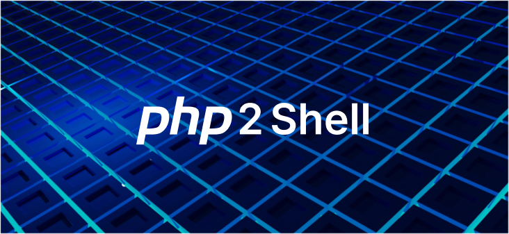

21 Ekim 2026'da PHP, iki kritik güvenlik açığını kapatan acil sürümler yayınladı. "PHP2Shell" adıyla anılan bu açıklar, saldırganın oturum açmadan sunucuda kod çalıştırmasına izin veriyor ve şu anda aktif olarak istismar ediliyor. Bu yazıda sunucunuzun etkilenip etkilenmediğini nasıl anlayacağınızı, neyi hangi sırayla yamalayacağınızı ve hemen yamalayamıyorsanız neler yapabileceğinizi anlatıyorum.

## Kısaca

- **Açıklar:** CVE-2026-109618 ve CVE-2026-109619. İkisi de CVSS v4.0 ile 9.2 (kritik).
- **Etki:** Kimlik doğrulaması gerektirmeyen uzaktan kod çalıştırma (RCE).
- **Kimler etkileniyor:** Web isteklerine yanıt veren her PHP kurulumu. PHP-FPM, Apache mod_php, php-cgi, LiteSpeed ve FrankenPHP dahil.
- **Yapılacak:** 8.5.12, 8.4.27, 8.3.36 veya 8.2.35'e yükseltin ve tüm PHP işlemlerini yeniden başlatın.
- **Durum:** Saldırılar yamadan önce başladı. Logları 17 Ekim'den itibaren gözden geçirin.

## Ne oldu?

İki açık da PHP motorunun kendisinde, yani üzerinde çalışan uygulamadan bağımsız. Bu yüzden WordPress, Laravel ya da kendi yazdığınız kod fark etmeksizin, PHP çalıştıran her web sunucusu risk altında.

**CVE-2026-109618** bellek yönetimiyle ilgili. PHP bir isteği hazırlarken belleği biterse, temizlik aşaması yarım kalmış veriyi geçerliymiş gibi işleyebiliyor. Bu da bellek bozulmasına yol açıyor.

**CVE-2026-109619** istekler arasında kalan veriyle ilgili. Bir istekten kalan bazı iç durumlar, ait oldukları bellek serbest bırakıldıktan sonra da yaşamaya devam ediyor. Aynı PHP işlemi bir sonraki isteği işlerken bu eski veriyi kullanabiliyor.

Teknik analizi Wiz araştırmacıları yayınladı. En yüksek risk Apache mod_php kurulumlarında: PHP'ye göre burada saldırı, uygulamanın kendi kodu hiç çalışmadan başarılı olabiliyor.

### Zaman çizelgesi

| Tarih | Olay |
|---|---|
| 17 Ekim | Amazon'un MadPot bal küpü ilk istismar girişimini kaydediyor. Açık henüz duyurulmamış. |
| 20 Ekim | Teknik ayrıntılar, 22 Ekim'deki planlı duyurudan önce sosyal medyaya sızıyor. |
| 21 Ekim | PHP yamalı sürümleri yayınlıyor. watchTowr bal küplerinde gerçek saldırılar görüyor. |
| 22 Ekim | Cloudflare WAF kuralları yayınlıyor. Searchlight Cyber açık kaynak bir tarayıcı yayınlıyor. |

Saldırıların duyurudan dört gün önce başlamış olması önemli: yamayı bugün yapmış olsanız bile sunucunuz o tarihten beri hedef olmuş olabilir.

## Etkileniyor muyum?

### 1. Bütün PHP kurulumlarını bulun

Sadece bildiğiniz sunucuları değil, gözden kaçabilecekleri de sayın: eski sanal makineler, Docker imajları, cPanel veya Plesk gibi kontrol panelleri, PHP gömülü gelen cihazlar ve uygulamalar. Örneğin Palo Alto Networks, tüm PAN-OS ve Panorama sürümlerinin etkilendiğini açıkladı.

### 2. Sürümü kontrol edin

```bash
php -v
```

Çıkan sürümü aşağıdaki tabloyla karşılaştırın:

| Dal | Yamalı sürüm | Not |
|---|---|---|
| 8.5 | 8.5.12 | Aktif destek |
| 8.4 | 8.4.27 | Aktif destek |
| 8.3 | 8.3.36 | Yalnızca güvenlik yaması |
| 8.2 | 8.2.35 | Yalnızca güvenlik yaması |
| 8.1, 8.0, 7.4 | Resmi sürüm yok | Dağıtım paketi, kaynak kod yaması ya da yükseltme |
| 7.3 ve öncesi | Yama yok | Desteklenen bir dala yükseltin |

Dikkat edilmesi gereken iki nokta var:

- **Komut satırındaki PHP ile web'deki PHP aynı olmayabilir.** `php -v` terminaldeki kurulumu gösterir. Web sunucusunun kullandığı sürümü görmek için `phpinfo()` çıktısına bakın.
- **Dağıtımlar sürüm numarasını değiştirmeden yama yapabilir.** Debian, Ubuntu, RHEL gibi dağıtımlar düzeltmeyi eski sürüm numarasına uygular. Bu durumda `php -v` eski görünür ama paket yamalıdır. Kesin bilgi için dağıtımınızın güvenlik duyurusuna bakın.

### 3. Hangi SAPI'yi kullandığınızı öğrenin

```bash
php -i | grep "Server API"
apachectl -M | grep php
```

İkinci komut bir sonuç döndürüyorsa Apache'de mod_php yüklü demektir. Bu, en riskli kurulum, öncelik verin.

## Yamalama

1. **İnternete açık sunuculardan başlayın.** Yamalı sürüme ya da dağıtımınızın yamalı paketine yükseltin.
2. **PHP işlemlerini yeniden başlatın.** Paketi güncellemek yetmez, çalışan işlemler eski kodu kullanmaya devam eder:

   ```bash
   sudo systemctl restart php8.3-fpm   # sürümünüze göre değiştirin
   sudo systemctl restart apache2      # mod_php kullanıyorsanız
   ```

3. **Container'ları yeniden derleyin.** Yamalı temel imajdan yeni imaj oluşturup yeniden dağıtın. Çalışan container'ın içinde paket güncellemek kalıcı değildir.
4. **Desteği biten sürümleri planlayın.** 8.1 ve öncesi için ya dağıtımınızın uzun süreli destek paketini kullanın ya da desteklenen bir dala geçin.

Remi deposundan (rpms.remirepo.net) PHP kuranlar dikkat: yamanın yayınlandığı gün bu depoda güncelleme yoktu. Depoyu kontrol edin, gerekirse dağıtım paketlerine geçin.

## Hemen yamalayamıyorsanız

watchTowr'un ifadesiyle, **hiçbir yapılandırma değişikliği bu açıkları tamamen kapatmıyor.** Aşağıdakiler yalnızca riski azaltır ve yamaya kadar zaman kazandırır.

**En güvenli seçenek erişimi kısıtlamak.** İngiltere'nin siber güvenlik merkezi NCSC, hemen yamalanamayan sistemlerin çevrimdışı alınmasını öneriyor. Bu mümkün değilse VPN arkasına alın ya da yalnızca bilinen IP'lere izin verin.

**php.ini ayarları:**

```ini
; CVE-2026-109619 için riski azaltır
session.upload_progress.enabled = 0

; PHP 8.5'te
fatal_error_backtraces = 0

; Dosya yüklemesi almıyorsanız 8M, alıyorsanız 32M
post_max_size = 8M

; Sürüm bilgisini başlıklarda gizler
expose_php = Off
```

Ayarları değiştirdikten sonra PHP işlemlerini yeniden başlatmayı unutmayın.

**Web sunucusu ve proxy:** İstek boyutu ve istek sayısı sınırlarını web sunucusu ya da ters proxy düzeyinde uygulayın.

**WAF:** Cloudflare, bilinen saldırı yöntemleri için ücretsiz plan dahil tüm müşterilere kurallar yayınladı. WAF yararlı bir ek katman ama yamanın yerini tutmaz.

## Saldırıya uğradım mı?

Saldırılar 17 Ekim'de başladığı için logları en az o tarihten itibaren inceleyin. SOCRadar'ın derlediği işaretler:

- İçinde `PHP_SESSION_UPLOAD_PROGRESS` geçen, tanımadığınız kaynaklardan gelen multipart POST istekleri
- İstek başlangıcında bellek sınırı hataları ve ani HTTP 500 artışları
- Anormal uzun ya da bozuk `PHPSESSID` çerezleri
- `php-fpm`, `php-cgi`, `httpd` veya `apache2` işlemlerinin kabuk, betik yorumlayıcısı ya da `curl`/`wget` gibi indirme araçları başlatması

Şüpheli bir şey bulursanız:

1. Sunucuyu ağdan ayırın.
2. Web sunucusu ve PHP loglarını saklayın.
3. Web kök dizininde yeni dosyalara, web shell'lere, yeni cron görevlerine ve tanımadığınız kullanıcı hesaplarına bakın.

Yamalamak, içeri girmiş bir saldırganı dışarı atmaz. Ele geçirildiğinden şüphelendiğiniz bir sunucuyu temiz bir kaynaktan yeniden kurmak en güvenli yoldur.

## Sonuç

PHP2Shell'i ciddiye almak için üç neden var: oturum açma gerektirmiyor, uygulamadan bağımsız olarak PHP'nin kendisini etkiliyor ve yama çıkmadan önce istismar edilmeye başlandı. Yapılacaklar sırasıyla şöyle: bütün PHP kurulumlarını bulun, yamalayın, işlemleri yeniden başlatın, logları 17 Ekim'den itibaren tarayın. Yamalayamadığınız sistemleri internetten uzak tutun.

Durum hâlâ gelişiyor. Kesin bilgi için PHP'nin resmi güvenlik duyurusunu ve NVD kayıtlarını takip edin.

## Kaynaklar

- [Help Net Security: PHP2Shell vulnerabilities patched](https://www.helpnetsecurity.com/2026/10/21/php2shell-php-vulnerabilities-patched-cve-2026-109618-cve-2026-109619/)
- [watchTowr: PHP2Shell FAQ](https://watchtowr.com/intelligence/php-cve-2026-109618-faq/)
- [watchTowr: PHP2Shell RCE Exploited](https://watchtowr.com/intelligence/php-remote-code-execution-php2shell/)
- [SOCRadar: PHP2Shell affected versions and fixes](https://socradar.io/blog/php2shell-cve-2026-109618-cve-2026-109619/)
- [Qualys: PHP2Shell: Find, Mitigate, and Patch Now](https://blog.qualys.com/vulnerabilities-threat-research/2026/10/20/php-announces-critical-security-release-for-two-vulnerabilities)
- [Imperva: PHP2Shell: When PHP Runs Out of Memory at the Wrong Moment](https://www.imperva.com/blog/php2shell-vulnerability-updates/)
- [Arctic Wolf: PHP2Shell](https://arcticwolf.com/resources/blog/php2shell-critical-php-vulnerabilities-enable-unauthenticated-remote-code-execution/)


